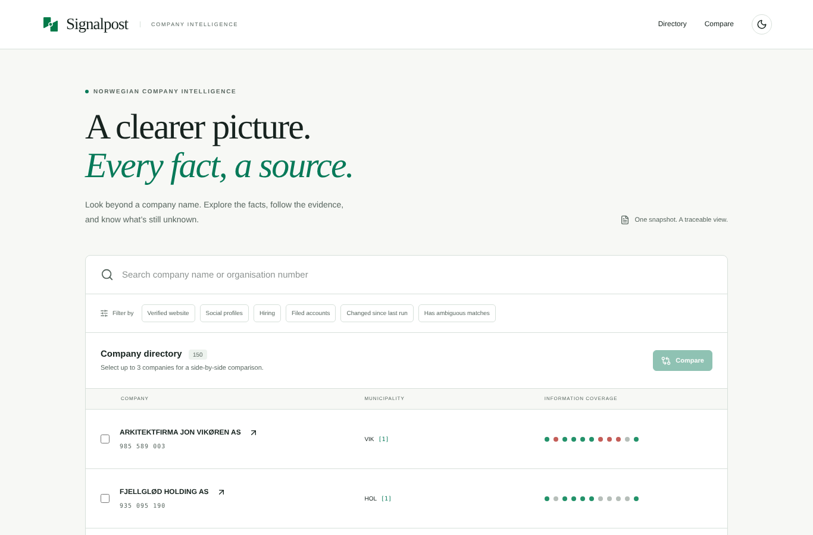
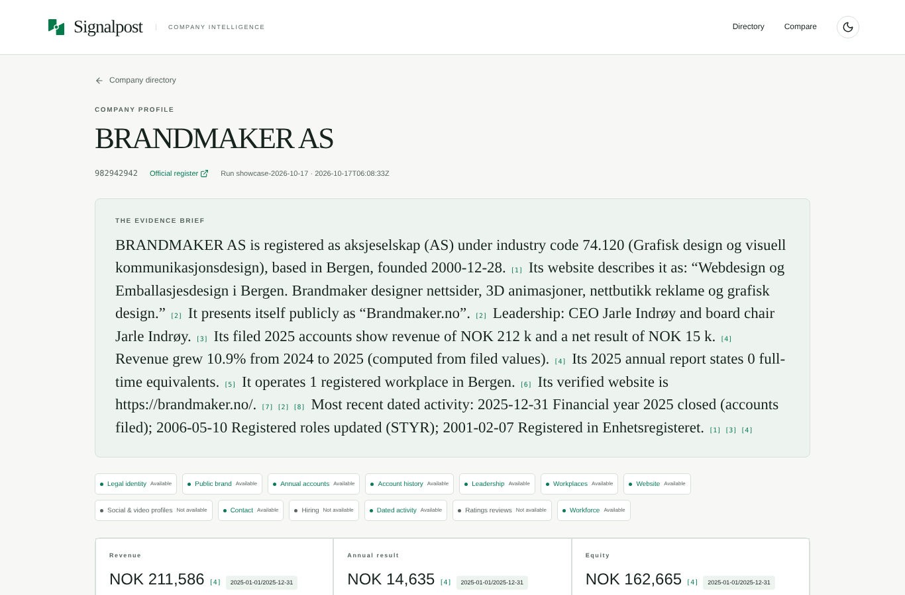
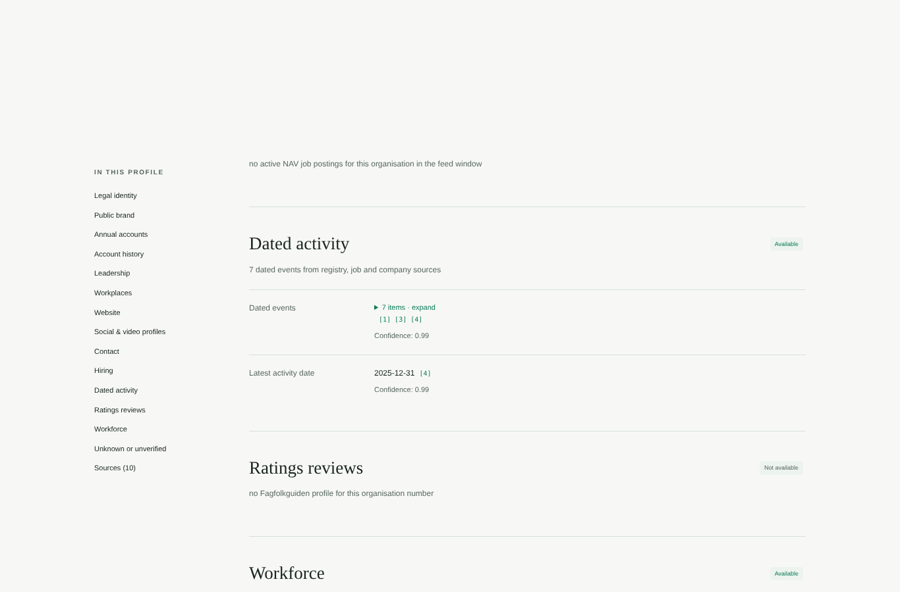
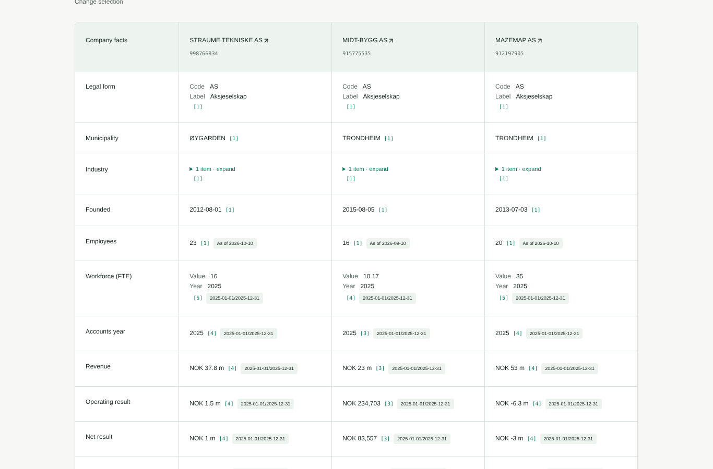
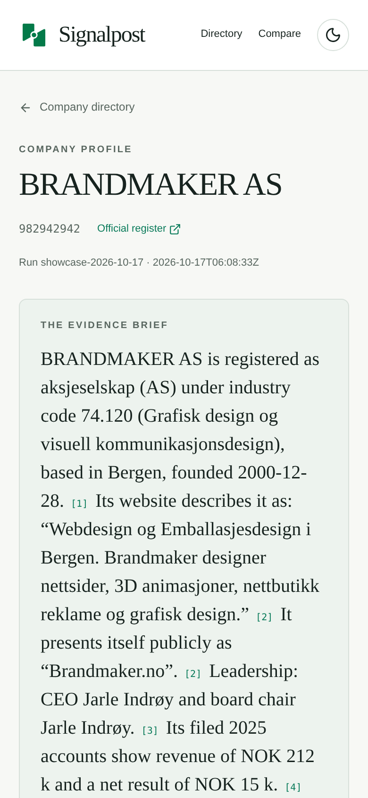

# Signalpost — Norwegian company research agent

Give it Norwegian organisation numbers. For each one it returns a single **terminal, evidence-backed company envelope**: legal identity, filed accounts and history, leadership, registered workplaces, a *verified* official website, company-owned social and video profiles, contact details, active job postings and dated public activity. Each fact carries its source URL, retrieval time, content hash and, where relevant, reporting period. Reruns refresh the profile, report what changed, and keep the earlier evidence.

Built for the Builderr **Signalpost** challenge. The repository is a **JBOX** project: the Next.js web app at the root (`app/`, `components/`, `lib/`) was generated with [JBOX](https://jboxai.com) and exported from JBOX to this repository (see the first commits). The Python research agent (`signalpost_agent/`) produces the data the app shows (`public/data/profiles.json`). Every run also writes a zero-dependency static viewer (`out/site/index.html`) of the same profiles.

## See the results

Every run writes a self-contained viewer next to its output: open **`out/site/index.html`** in any browser. You can search, filter, compare companies side by side, and click any citation to see its source. The JBOX web app (`app/`) shows the same profiles. Live demo with 150 real companies: **https://rohithknairhere.github.io/signalpost/**

| Directory | Company profile with cited summary |
|---|---|
|  |  |
| **Numbered sources (URL, retrieval time, SHA-256)** | **Side-by-side comparison** |
|  |  |



## One command

```bash
uv run signalpost --organisations companies.jsonl --bulk brreg-enheter.csv --output out/envelopes.jsonl
```

- `--organisations`: JSON, JSONL (`{"organisation_number": "..."}` per line) or plain text, one number per line.
- `--bulk` (optional): the Brønnøysund bulk snapshot (`/enheter/lastned/csv`, gzipped or plain). Without it, the live registry anchors identity.
- Outputs: `out/envelopes.jsonl` (one terminal envelope per input), `out/profiles.jsonl`, `out/run-report.json` and a static viewer at `out/site/index.html`.

The starter kit's command also works unchanged:

```bash
uv run python scripts/run_competition_batch.py --organisations batch.jsonl --bulk brreg.csv \
  --output out/envelopes.jsonl --profiles-output out/profiles.jsonl --report out/report.json \
  --run-id official-001 --expected-count 100
```

Optional, for workforce facts from scanned annual reports: `apt-get install poppler-utils tesseract-ocr` (or `brew install poppler tesseract`). Everything else works without them.

Without `uv`, run `python -m venv .venv && .venv/bin/pip install . && .venv/bin/signalpost ...`. Python 3.10 or later is required. The only dependencies are `beautifulsoup4` and `lxml`, pinned in `uv.lock`.

| Flag | Default | Purpose |
|---|---|---|
| `--state-dir` | `state/` | Snapshots for refresh, plus the NAV feed cache |
| `--previous` | — | Previous envelopes JSONL to refresh against (instead of `--state-dir`) |
| `--max-requests` | 1,900 per 100 companies | Hard cap on outbound HTTP requests, scaled with the batch (19,000 for 1,000 companies). Requests for core official records are reserved before any optional source |
| `--time-budget-minutes` | 42 | Hard wall-clock budget for the whole batch, under the 45-minute limit. Every company still gets an envelope if it runs out |
| `--workers` | 24 | Companies researched in parallel |
| `--expected-count` | — | Fail fast if the input count differs |

## Models, APIs, licences and cost

- **Models:** none. Synthesis is deterministic and evidence-bound, with no LLM calls.
- **Expected external API cost per official run:** **$0.00**. All sources are free public APIs or public web pages.
- **Requests:** about 17–18 per company at 100 companies without the bulk file (≈1,750 including the shared NAV feed, filing-year lists and annual-report copies), and about 13.5 per company at 1,000 companies with it. Always under `--max-requests`. The agent plans its budget from the batch size and never exceeds `--max-requests`.
- **Runtime:** about 10 minutes for 100 companies and about 31 minutes for 1,000 companies, with default flags and annual-report OCR. Annual reports are downloaded and read in a background pipeline, so they never slow website research.
- **Any batch size, any budget:** the agent plans from the batch size, the request cap and the time budget. Core official records (accounts, people, addresses) come first. Website depth, ratings and OCR shrink before anything core is dropped, and a watchdog guarantees one terminal envelope per company before the deadline. Tested with default flags: 100 companies in about 10 minutes, 300 in 26 minutes, 1,000 in 31 minutes, plus a forced 2-minute budget (all 100 envelopes, completed).
- **Code licence:** MIT.

## Sources and rights

| Source | Use | Rights |
|---|---|---|
| Brønnøysundregistrene, Enhetsregisteret (bulk + API) | Identity, status, industry, addresses, employees, roles, registered workplaces | NLOD 2.0 open data |
| Regnskapsregisteret API + filing-copy list | Filed annual accounts (as filed, never estimated), history, PDF links | NLOD 2.0. The copy-year endpoint is paced at ≤30/min |
| NAV `pam-stilling-feed` (public token) | Active job postings, confirmed by employer organisation number | [NAV API terms](https://arbeidsplassen.nav.no/vilkar-api). Inactive ads are never published |
| Regnskapsregisteret filing copies (PDF) | Workforce (full-time equivalents / average employees) as stated in the latest filed annual accounts, read with OCR | NLOD 2.0. Same ≤30/min pacing. Needs the optional `pdftoppm` + `tesseract` tools; skipped (and reported) when absent |
| Fagfolkguiden (`/bedrift/<slug>-<orgnr>`) | Customer rating and count, keyed by organisation number and checked against the profile's schema.org identifier | Public pages, `/bedrift/` allowed by robots.txt. Skipped where ratings do not apply (holding, finance, property, housing co-ops) |
| Wikidata SPARQL (one query per batch) | Items whose Norwegian org. number (P2333) equals ours: website, profiles, LEI, Wikipedia | CC0 |
| Company websites | Verified official site: self-description, contact, profiles, careers, dated news | Public pages. `robots.txt` honoured, identified user agent, per-host pacing |

No search-engine scraping, and no LinkedIn, Meta, Google or Indeed crawling. No keys or accounts are needed. **Politeness:** requests are paced per host, and `robots.txt` is honoured. A "too many requests" (429/503) response puts the host on cooldown, honouring `Retry-After` and otherwise backing off exponentially. Core registry calls wait and retry; optional calls to a cooling host are skipped. The run report counts rate-limited responses per host. Social profiles come only from links on the verified company website, or from Wikidata matched on the organisation number. Person data stays in the company-role context, and birth dates are never stored. URLs are fetched only when public (SSRF-guarded, re-checked on every redirect). No secrets are needed.

## How accuracy is protected

It is better to miss a fact than to attach it to the wrong company, so:

1. **The organisation number is the anchor.** Registry, accounts, roles and workplaces come from endpoints keyed by the number.
2. **A website is published only when it proves its own identity:** the organisation number on the site (including in script data for JavaScript-built sites), or the exact legal name with a domain that matches the name. A registry-declared site may also be verified by all of its registry contact details (phone, e-mail and address). A shared phone or address on its own only proves co-location (accountants, housing managers, franchise chains), so it never verifies a site. Housing-manager and directory domains never verify a member company. A site showing **another** company's number and not ours is rejected, unless a registry lookup shows that number belongs to a web agency, IT or accounting firm with an unrelated name (footer credits). Redirects to an unrelated domain (franchise pages) and parked domains are rejected. Uncertain candidates are returned as `ambiguous` with the evidence for and against.
3. **Own, another organisation's, or group site.** Every verified site is classified, and only the company's **own** site is published:
   - **own:** the organisation number is on it, or the domain carries the company's name, or it is the registry-declared site naming the company with its registry phone, e-mail and address.
   - **another organisation's site** (property manager, dealer page on a brand site, municipality page, sister brand): returned as `ambiguous`, never published.
   - **group:** it names sister or parent entities, it is a "…gruppen"/"…group" domain, a foreign parent's domain, the Norwegian section of a multinational site (`example.com/no`), a parent's e-mail domain, or an operating company's site for a holding company. Never published.
4. **Profiles** are published only from the company's own site, and only when they are declared in structured data or named like the company, its domain or its brand. A common industry word ("regnskap", "bygg") is not a name match. These are rejected: parent-group handles ("…gruppen", "…group", "-ab", "-gmbh"), international group pages for a "… Norway AS" (no country word in the handle), owners' personal accounts, and web-agency, theme and "designed by" links.
5. **News** comes only from the company's own site: dated articles in its structured data, dated news listings, and its own RSS/Atom feed. Every item has a date and a link on the company's domain.
6. **Jobs** are name-shortlisted from the NAV feed, then confirmed from each ad's employer organisation number (the company or one of its registered workplaces). Open positions the verified website itself publishes as schema.org `JobPosting` are added as company-owned evidence.
7. **Workforce** is published only when the filed annual report states it explicitly; the claim quotes the OCR'd sentence and page.
8. **Financial values** are copied from Regnskapsregisteret with currency and period. The one derived figure (year-on-year revenue change) is labelled as derived.

## Output contract

Every input gets exactly one envelope with `terminal_status` (`completed`/`failed`) and, for each of 12 information families, an honest state: `available`, `not_available`, `blocked`, `not_applicable`, `ambiguous` or `failed`. Absence is never turned into zero.

```json
{
  "organisation_number": "810034882",
  "run": {"run_id": "...", "started_at": "...", "completed_at": "...", "terminal_status": "completed"},
  "families": {"official_website": {"availability": "available", "reason": "verified via organisation_number_on_site, ..."}},
  "claims": [{"id": "cl-…", "family": "annual_accounts", "field": "revenue", "value": {"amount": 10021242.0, "currency": "NOK"},
              "reporting_period": "2025-01-01/2025-12-31", "confidence": 0.99, "evidence_ids": ["ev-…"]}],
  "evidence": [{"id": "ev-…", "source_url": "https://data.brreg.no/regnskapsregisteret/regnskap/810034882",
                "source_class": "official_annual_accounts", "retrieved_at": "...", "content_sha256": "...", "reporting_period": "..."}],
  "synthesis": {"summary": "...", "sentences": [{"text": "...", "evidence_ids": ["ev-…"]}], "unknowns": [...]},
  "changes": [], "history": [], "refresh": {...}, "operations": {"requests": 12, "third_party_cost_usd": 0},
  "profile": {"...": "starter-kit-compatible copy"}
}
```

Families: `legal_identity`, `public_brand`, `annual_accounts`, `account_history`, `leadership`, `registered_workplaces`, `official_website`, `company_profiles`, `website_contact`, `hiring`, `public_activity`, `ratings_reviews`, plus `workforce` when OCR tools are installed.

## Refresh

Snapshots are kept in `--state-dir` (or passed with `--previous`). A change is a difference in a claim's value, not in retrieval time, so **rerunning on the same source data produces zero changes and no duplicates**. When a source is down or blocked, the last verified claims are **carried forward** and labelled, instead of being reported as removed. Last run's verified website is re-checked first. Earlier evidence is preserved in `history`.

## Verify it yourself

```bash
uv run --group dev pytest -q                            # offline unit tests
uv run signalpost --organisations examples/smoke-100/companies.jsonl --output out/envelopes.jsonl --expected-count 100
open out/site/index.html                                 # search, compare, click any citation
```

`examples/smoke-100/` contains the 100-company smoke-test batch, its run report and its envelopes.

## Web app (built with JBOX)

The app is read-only and has no database, login or secrets. It reads `public/data/profiles.json`. To show a new run in the app:

```bash
uv run signalpost --organisations companies.jsonl --output runs/envelopes.jsonl --web-data public/data/profiles.json
pnpm install && pnpm build:static        # static site in out/  (or: pnpm dev)
```

Pages: a searchable, filterable **directory** with a status dot per information family; a **company profile** with the cited summary, key filed numbers, what changed, every family with its claims, the unknowns and a numbered **source list** (URL, retrieval time, SHA-256); and a side-by-side **compare** view for up to three companies. It is responsive and supports dark mode.

## Repository layout

```
signalpost_agent/   research agent (registry, website, jobs, wikidata, assemble, synthesis, refresh, viewer, cli)
scripts/            starter-compatible entry point
tests/              offline tests
examples/smoke-100/ smoke-test input, report and envelopes
app/ components/ lib/   JBOX-generated Next.js app (search, profile with citations, compare)
public/data/profiles.json   dataset the app reads (written by the agent)
docs/WEB_APP.md     JBOX's notes on the web app
```
